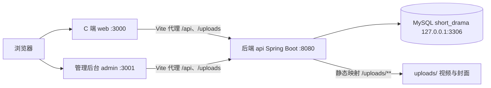

# 短剧 Web APP（仿红果短剧 · 简化版）

> AI Coding 现场实战题：使用 AI Coding 工具开发一个类似「红果短剧」的简化版短剧 Web APP。题面见 [docs/REQUIREMENTS.md](docs/REQUIREMENTS.md)，产品需求见 [docs/PRD.md](docs/PRD.md)。

一个前后端与数据库真实打通的三工程 monorepo：访客可浏览竖屏短剧、注册登录后可点赞收藏，管理员通过独立后台维护短剧内容。目标是本地一条命令启动、不依赖外网即可现场演示。

## 功能概览

| 模块 | 功能 | 状态 |
|---|---|---|
| 用户模块 | 注册 / 登录（JWT 会话保持）/ 退出 | ✅ 可用 |
| 内容展示 | 首页推荐流、短剧详情、竖屏沉浸播放、分类浏览、响应式三档布局 | ✅ 可用 |
| 互动 | 点赞 / 收藏 / 我的收藏 | 部分可用（按钮与状态回显已就位，写库待里程碑 4） |
| 观看增强 | 滑动切集、自动连播、记忆续播、观看历史、搜索 | 规划中 |
| 管理后台 | 短剧与剧集增删改查、文件上传、用户管理（独立工程，仅 PC） | 开发中 |

当前进度：里程碑 1「脚手架与数据底座」✅、里程碑 2+3「用户链路与核心演示路径」✅ 均已过验收门禁——访客可浏览首页网格与详情播放，注册登录后点赞收藏状态实时回显，受保护接口无 token 返回 401（见 [docs/plan/](docs/plan/) 与 [docs/devlog.md](docs/devlog.md)）。

## 技术栈

| 层 | 技术 |
|---|---|
| 后端 | Java 21 · Spring Boot 3.5 · Spring Data JPA · Spring Security + JWT（jjwt）· Maven |
| 数据库 | 本机 MySQL 26.7（127.0.0.1:3306，专用库 `short_drama`，utf8mb4） |
| C 端前端 | Vite · React · TypeScript · Tailwind CSS v4 · React Router · Axios |
| 管理后台 | 同 C 端，另加 Ant Design |
| 文件存储 | 后端本地磁盘 `apps/api/uploads/`，经 `/uploads/**` 静态提供 |

## 系统架构



三工程职责：`apps/api` 是唯一后端，同时服务 C 端与后台，按角色区分接口权限；`apps/web` 面向访客与注册用户（响应式）；`apps/admin` 仅面向管理员（仅 PC）。开发期两个前端用 Vite dev proxy 把 `/api`、`/uploads` 转发到 8080，免跨域配置。

## 快速开始

### 前置条件

| 依赖 | 要求 | 检查命令 |
|---|---|---|
| JDK | 21+ | `java -version` |
| Node.js | 20+（含 pnpm 10） | `node -v && pnpm -v` |
| MySQL | 本机 mysqld 运行中，库 `short_drama` 存在 | `mysql -h127.0.0.1 -uroot -p -e 'SHOW DATABASES'` |

首次需创建数据库（utf8mb4）：

```sql
CREATE DATABASE IF NOT EXISTS short_drama
  CHARACTER SET utf8mb4 COLLATE utf8mb4_unicode_ci;
```

### 一键启动

```bash
./scripts/dev.sh
```

同时拉起三服务（日志写入 `logs/api.log`、`logs/web.log`、`logs/admin.log`），Ctrl-C 一键全停。

### 分服务启动

| 服务 | 命令 | 地址 |
|---|---|---|
| 后端 | `cd apps/api && ./mvnw spring-boot:run` | http://localhost:8080 |
| C 端 | `cd apps/web && pnpm dev` | http://localhost:3000 |
| 管理后台 | `cd apps/admin && pnpm dev` | http://localhost:3001 |

### 启动验证

```bash
curl http://localhost:8080/api/ping   # {"message":"pong",...} 即后端与 MySQL 连接正常
```

浏览器打开 http://localhost:3000 ：首页渲染出 6 部短剧封面网格即前后端与数据库链路全通（数据来自 MySQL，无 mock）。

## 演示账号

| 账号 | 密码 | 角色 | 说明 |
|---|---|---|---|
| `admin` | `admin123` | ADMIN | 管理后台 + 全部用户能力 |
| `demo` | `demo123` | USER | 普通用户 |

> 账号由种子数据在空库首次启动时自动创建；登录功能已于里程碑 2 上线，可直接在 C 端登录（登录页提供快捷填充按钮）。

## 数据库说明

- 连接配置在 `apps/api/src/main/resources/application.yml`，凭据默认 `root / root123`（本机演示口径），支持环境变量覆盖：`DB_USERNAME` / `DB_PASSWORD`。
- 建表：JPA `ddl-auto=update`，后端启动自动建表，无需手工执行 SQL。
- 种子数据：空库（用户表为空）首次启动由 `CommandLineRunner` 自动导入，重复启动不重复灌入。
- 种子媒体（视频/封面）落 `apps/api/uploads/`，不入 git；重建两步：`./scripts/fetch-seed-media.sh 50`（下载原始素材，幂等）→ `./scripts/allocate-seed-media.sh`（按分类选片复制 + 生成封面，幂等）。

## 目录结构

- `apps/` — 三个独立工程
  - `api/` — 后端服务（Spring Boot，包结构 `com.shortdrama.api`：`config` / `security` / `entity` / `repository` / `service` / `controller` / `dto` / `exception` 分层）
  - `web/` — C 端（Vite + React + Tailwind；首页 / 详情 / 竖屏播放 / 登录注册四条路由已通）
  - `admin/` — 管理后台（Vite + React + Ant Design）
- `docs/` — 全部项目文档（见下表）
- `scripts/` — `dev.sh` 一键启动；`fetch-seed-media.sh` + `allocate-seed-media.sh` 种子媒体下载与分配（幂等）
- `logs/` — 运行日志（gitignore）
- `AGENTS.md` — AI 协作约定（供编码工具读取，固定在根目录）

## 文档索引

| 文档 | 内容 |
|---|---|
| [docs/REQUIREMENTS.md](docs/REQUIREMENTS.md) | 题面原文（需求唯一来源） |
| [docs/PRD.md](docs/PRD.md) | 产品需求文档（功能清单、页面结构、数据设计、接口草案、里程碑） |
| [docs/ARCHITECTURE.md](docs/ARCHITECTURE.md) | 架构决策（工程结构、技术栈、数据模型） |
| [docs/plan/](docs/plan/) | 分阶段实施计划（现行计划唯一存放处；第一阶段：数据底座与种子资源） |
| [docs/devlog.md](docs/devlog.md) | 施工日志（每阶段门禁结论与偏差记录） |

## 开发进度（按 PRD 里程碑）

1. **脚手架与数据底座** — 三工程骨架 ✅ / 数据库直连 ✅ / 种子数据与媒体资源 ✅（2026-10-16 验收门禁通过）
2. 用户链路（注册、登录、JWT 贯通）— ✅（2026-10-16 验收门禁通过）
3. 核心演示路径（首页 → 详情 → 播放、响应式布局）— ✅（2026-10-16 验收门禁通过）
4. 互动闭环（点赞、收藏）— 待开工（按钮 UI 与状态回显已就位）
5. 管理后台（登录、短剧/剧集 CRUD、文件上传）— 待开工
6. 体验加分项（滑动切集、连播、续播、历史、搜索）— 待开工
7. 联调彩排（全流程走查 + 演示脚本 + README 收尾）— 待开工
