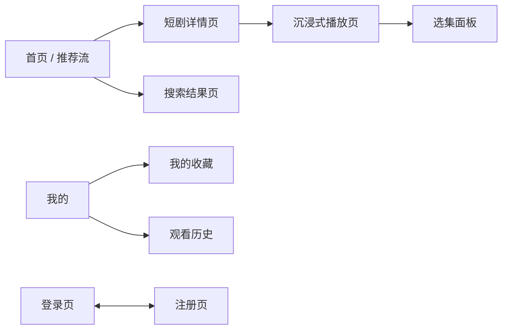
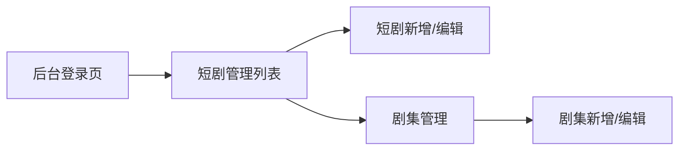
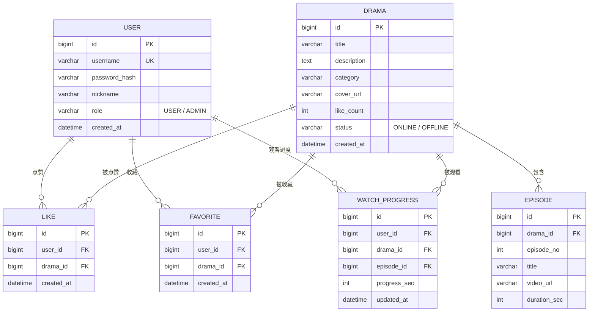
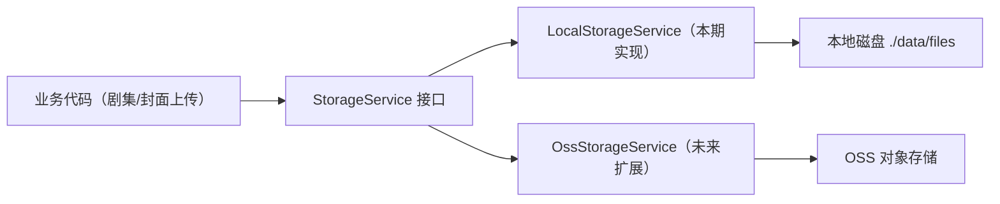

# PRD — 短剧 Web APP（仿红果短剧简化版）

| 项目 | 内容 |
|---|---|
| 文档版本 | v1.0 |
| 创建日期 | 2026-10-16 |
| 需求来源 | [REQUIREMENTS.md](REQUIREMENTS.md)（AI Coding 现场实战题题面） |
| 产品形态 | Web APP（C 端响应式：手机 / 平板 / PC 三档；管理后台仅 PC） |
| 交付方式 | 本地启动运行，现场演示并讲解设计思路 |

## 一、项目背景与目标

开发一个类似「红果短剧」的简化版短剧 Web APP：以竖屏短剧内容为核心，用户可注册登录、浏览并沉浸式观看短剧、对剧集点赞收藏；运营人员通过管理后台维护短剧内容。

本项目为限时现场实战题，核心目标按优先级排序：

1. **可演示**：`启动后端 → 启动前端 → 现场演示` 路径全程稳定可用，不依赖外部网络。
2. **全覆盖**：题目硬性要求的六项功能（Java 后端、React 前端、注册登录、内容展示、点赞收藏、管理后台）一项不缺，前后端与数据库真实打通。
3. **像红果**：交互形态贴近红果短剧核心体验（竖屏沉浸播放、滑动切集），让评委一眼识别产品对标。

## 二、对标产品功能调研摘要

红果短剧（字节跳动旗下免费短剧 App）的核心功能结构：

| 模块 | 红果短剧功能 | 本项目取舍 |
|---|---|---|
| 观看 | 竖屏沉浸播放、选集、自动连播、记忆续播、倍速、投屏 | 保留竖屏播放、选集、连播、续播；倍速可选；投屏不做 |
| 内容发现 | 个性化推荐流、分类频道、榜单、搜索、每日更新 | 保留分类筛选与搜索（简单 SQL 实现）；推荐流用固定排序替代 |
| 用户互动 | 注册登录（手机号/抖音）、点赞、收藏追剧、观看历史、评论 | 保留账号密码注册登录、点赞、收藏、观看历史；评论为可选 |
| 运营激励 | 金币、签到、提现、激励广告 | 全部不做 |
| 扩展内容 | 电影、小说、听书等 | 不做 |

## 三、角色定义

| 角色 | 说明 | 获取方式 |
|---|---|---|
| 访客 | 未登录用户，可浏览短剧列表，观看前 N 集后引导登录 | 默认身份 |
| 注册用户 | 可观看全部剧集，可点赞、收藏、查看历史 | 注册页自助注册；预置演示账号 `demo / demo123` |
| 管理员 | 除普通用户能力外，可登录独立管理后台维护短剧内容 | 预置账号 `admin / admin123`，数据库标记角色 |

## 四、功能需求

优先级定义：P0 = 题目硬性要求，必须完成；P1 = 强烈建议，演示价值高且成本低；P2 = 时间允许才做。

### 4.1 用户模块（P0）

| 编号 | 功能 | 描述 | 验收标准 |
|---|---|---|---|
| US-01 | 注册 | 用户名 + 密码注册，用户名校验唯一，密码 BCrypt 加密存储 | 重复用户名返回明确错误提示；注册成功自动登录 |
| US-02 | 登录 | 用户名 + 密码登录，签发 JWT，前端持久化令牌 | 错误凭证提示「用户名或密码错误」；登录后跳回来源页 |
| US-03 | 会话保持 | 前端请求携带 JWT，过期或非法令牌跳转登录页 | 刷新页面保持登录态；令牌过期后接口返回 401 |
| US-04 | 退出登录 | 清除本地令牌 | 退出后点赞/收藏等操作要求重新登录 |

### 4.2 短剧内容展示（P0）

| 编号 | 功能 | 描述 | 验收标准 |
|---|---|---|---|
| DR-01 | 首页推荐流 | 竖版封面卡片网格，展示封面、剧名、集数、点赞数；列数随屏幕宽度自适应 | 数据来自后端接口，非前端写死 |
| DR-02 | 短剧详情 | 剧名、封面、简介、分类、总集数、点赞/收藏入口、选集列表 | 点赞收藏状态随登录用户实时回显 |
| DR-03 | 剧集播放 | 竖屏沉浸式播放页，原生 video 播放剧集视频；宽屏下播放区保持竖屏比例居中 | 视频本地资源可正常播放，无外部网络依赖 |
| DR-04 | 分类浏览 | 按题材分类（甜宠/都市/逆袭/古装/悬疑等）筛选列表 | 分类数据与剧关联，筛选结果正确 |
| DR-05 | 响应式布局 | C 端全部页面兼容手机（<768px）、平板（768~1279px）、PC（≥1280px）三档宽度，规则见 5.3 | 三档宽度下布局无错位、无横向滚动条 |

### 4.3 点赞与收藏（P0）

| 编号 | 功能 | 描述 | 验收标准 |
|---|---|---|---|
| IN-01 | 点赞/取消点赞 | 对整部剧点赞，幂等切换，更新剧的总点赞数 | 同一用户重复请求不产生重复记录；未登录引导登录 |
| IN-02 | 收藏/取消收藏 | 收藏整部剧到「我的收藏」 | 同上 |
| IN-03 | 我的收藏列表 | 个人中心展示收藏过的剧，点击可进入详情 | 收藏列表与数据库一致 |

### 4.4 观看增强（P1）

| 编号 | 功能 | 描述 | 验收标准 |
|---|---|---|---|
| PL-01 | 上下滑动/滚轮切集 | 手机端触摸滑动切集；平板、PC 端支持滚轮与键盘方向键切集 | 切换流畅，URL 与当前集同步 |
| PL-02 | 自动连播 | 当前集播放结束自动进入下一集 | 最后一集结束后停留在选集或返回提示 |
| PL-03 | 选集列表 | 播放页可拉出选集面板，标记已看/当前集 | 跳集后播放进度正确 |
| PL-04 | 记忆续播 | 播放进度定时/暂停时上报服务端；再次进入该剧自动从上次集数与进度续播 | 换浏览器标签页重新打开，进度仍在；讲解时作为「前后端真实打通」的现场证据 |
| PL-05 | 观看历史 | 个人中心「观看历史」列表，点击直接续播 | 与 PL-04 共用同一份进度数据 |
| PL-06 | 搜索 | 首页按剧名关键词搜索 | 模糊匹配，空结果有提示 |

### 4.5 管理后台（P0）

管理后台为**独立前端工程**（独立端口部署，不占用 C 端路由），仅兼容 PC 宽度，不做移动端适配。仅管理员角色可登录，前端隐藏入口 + 后端接口鉴权双重控制。

| 编号 | 功能 | 描述 | 验收标准 |
|---|---|---|---|
| AD-01 | 短剧列表管理 | 分页表格展示全部短剧（封面缩略图、剧名、分类、集数、状态、创建时间） | 数据与数据库一致 |
| AD-02 | 短剧新增 | 表单录入：剧名、简介、分类、封面（本地上传或 URL）、状态 | 必填校验完整；新增后前台可见 |
| AD-03 | 短剧编辑 | 修改任意字段 | 前台实时生效 |
| AD-04 | 短剧删除/上下架 | 删除需二次确认；下架剧前台隐藏但保留数据 | 删除后关联点赞收藏数据级联处理 |
| AD-05 | 剧集管理 | 某部剧下的剧集列表，可新增/编辑/删除/排序剧集（集数、标题、视频本地上传或 URL） | 剧集变更后前台播放页同步 |
| AD-06 | 文件上传 | 封面/视频上传到服务端文件存储，返回可访问 URL；存储实现细节见 7.3 | 上传后的 URL 前台可直接访问播放 |

### 4.6 种子数据（P0）

| 编号 | 内容 | 描述 |
|---|---|---|
| SD-01 | 初始账号 | `admin / admin123`（管理员）、`demo / demo123`（普通用户） |
| SD-02 | 种子短剧 | 4~6 部短剧，覆盖至少 3 个分类，每部 3~5 集 |
| SD-03 | 媒体资源 | 视频与封面**下载至后端本地静态目录**，启动即可播放，杜绝现场网络依赖 |
| SD-04 | 初始化方式 | 应用启动时检测空库自动导入（schema + data SQL 或 CommandLineRunner） |

### 4.7 明确不做（本期范围外）

金币/签到/提现等网赚激励体系、个性化推荐算法、投屏、离线下载、第三方登录（手机号验证码/抖音授权）、付费解锁、弹幕、消息通知、剧集评论（P2 可选）、多语言、React Native / Flutter 客户端。

## 五、页面结构

### 5.1 C 端（响应式 Web APP）

- 首页与播放页是演示主路径，视觉整洁度优先。
- 三档宽度自适应（规则见 5.3），核心演示路径在三档宽度下都需可用。

### 5.2 管理后台（独立工程，仅 PC）

- 独立工程、独立端口（3001），与 C 端无路由耦合，仅通过后端 API 交互。
- 使用 Ant Design 快速搭建，表格 + 表单为主，不追求视觉定制，不做移动端适配。
- 后台自带独立登录页，仅接受管理员角色令牌。

### 5.3 C 端响应式布局规则（三档断点）

调研结论：红果短剧官方无原生 PC 网页版（电脑端为模拟器运行竖屏 App）。同类竖屏短剧产品的宽屏通行做法是**主内容锁定手机宽度居中、两侧留装饰或信息位**，而非把竖屏视频强行拉宽。本项目沿用该做法并扩展为完整三档：

| 断点 | 宽度 | 布局规则 |
|---|---|---|
| 手机 | <768px | 单列全屏沉浸布局；首页双列封面网格；底部 Tab 导航（首页/我的） |
| 平板 | 768~1279px | 内容区限宽（约 720px）居中；首页 3~4 列封面网格；播放页播放区保持 9:16 竖屏居中，选集以抽屉/侧栏形式展开 |
| PC | ≥1280px | 内容区限宽（约 1200px）居中；首页 5~6 列封面网格 + 顶部导航栏；播放页采用「中央竖屏播放区（约 400px 宽）+ 右侧信息栏（简介/选集/点赞收藏）」双栏布局，两侧留白可放装饰背景 |

统一原则：竖屏视频在任何宽度下都保持 9:16 原始比例，只缩放、不裁切、不拉宽；交互上手机用触摸滑动、平板与 PC 用滚轮/方向键/点击。

## 六、数据设计（草案）

约束说明：`LIKE`、`FAVORITE` 以 `(user_id, drama_id)` 建唯一索引保证幂等；`WATCH_PROGRESS` 以 `(user_id, drama_id)` 建唯一索引，每部剧只保留最新一条进度。

## 七、技术方案概要

### 7.1 总体选型

| 层 | 选型 | 理由 |
|---|---|---|
| 后端 | Spring Boot 3 + Spring Data JPA + Maven | Java 题目硬性要求；JPA 快速建表 |
| 鉴权 | JWT（无状态）+ BCrypt 密码加密 | 免 session 存储，前后端分离标准做法 |
| 数据库 | 本机 MySQL（26.7，日历版本号体系），专用库 `short_drama` | 开发者本机已安装运行，3306 端口直连，免容器 |
| 前端 C 端 | Vite + React + React Router + CSS 媒体查询响应式 | React 题目硬性要求；三档断点自适应 |
| 管理后台 | 独立工程：Vite + React + Ant Design | 表格表单开箱即用，与 C 端解耦 |
| 文件存储 | 本地磁盘存储，经 StorageService 抽象层访问 | 本期不上 OSS，但预留扩展能力（见 7.3） |
| 开发联调 | 两个前端各自用 Vite dev proxy 转发 `/api` 到后端 | 免跨域配置 |

### 7.2 工程结构（三个独立项目）

| 工程 | 目录 | 默认端口 | 说明 |
|---|---|---|---|
| 后端服务 | `apps/api/` | 8080 | 唯一后端，同时服务 C 端与后台，通过角色鉴权区分接口权限 |
| C 端前端 | `apps/web/` | 3000 | 响应式 Web APP，面向访客与注册用户 |
| 管理后台前端 | `apps/admin/` | 3001 | 独立 React 工程，面向管理员，仅 PC |

三工程同一仓库 monorepo 管理，各自独立构建启动；后端通过 Spring Security 按角色控制 `/api/admin/**` 接口，C 端与后台共享 `/api/auth` 认证体系。

### 7.3 文件存储抽象

- 业务代码只依赖 `StorageService` 接口（`store / delete / getUrl`），不知道文件落在哪。
- 本期实现 `LocalStorageService`：文件写入服务端本地目录（如 `./data/files`），经 `/files/**` 静态映射对外提供访问。
- 未来扩展 OSS 时新增 `OssStorageService` 实现并通过配置切换（`storage.type=local|oss`），业务代码与数据库中的 URL 结构保持不变。

## 八、接口清单（草案）

统一前缀 `/api`，除标注外均需登录。

| 方法 | 路径 | 说明 | 鉴权 |
|---|---|---|---|
| POST | /api/auth/register | 注册 | 公开 |
| POST | /api/auth/login | 登录，返回 JWT | 公开 |
| GET | /api/dramas | 短剧列表（分页、分类、关键词、排序） | 公开 |
| GET | /api/dramas/{id} | 短剧详情（含当前用户点赞/收藏状态） | 可选登录 |
| GET | /api/dramas/{id}/episodes | 剧集列表 | 公开 |
| POST | /api/dramas/{id}/like | 点赞/取消点赞（幂等切换） | 登录 |
| POST | /api/dramas/{id}/favorite | 收藏/取消收藏（幂等切换） | 登录 |
| GET | /api/me/favorites | 我的收藏列表 | 登录 |
| GET | /api/me/history | 观看历史（进度列表） | 登录 |
| PUT | /api/me/progress | 上报/更新观看进度 | 登录 |
| GET | /api/admin/dramas | 后台短剧分页列表 | 管理员 |
| POST | /api/admin/dramas | 新增短剧 | 管理员 |
| PUT | /api/admin/dramas/{id} | 编辑短剧 | 管理员 |
| DELETE | /api/admin/dramas/{id} | 删除短剧 | 管理员 |
| POST | /api/admin/dramas/{id}/episodes | 新增剧集 | 管理员 |
| PUT | /api/admin/episodes/{id} | 编辑剧集 | 管理员 |
| DELETE | /api/admin/episodes/{id} | 删除剧集 | 管理员 |
| POST | /api/admin/files/upload | 上传封面/视频文件，返回可访问 URL | 管理员 |

统一响应结构：`{ code, message, data }`，业务错误用非 0 code + 200/4xx 语义化 HTTP 状态。

## 九、非功能需求

| 项 | 要求 |
|---|---|
| 可运行性 | 后端一条命令、C 端与后台各一条命令完成启动（共三个工程）；README 写明全部启动步骤 |
| 演示兜底 | 视频、封面全部存储于本地文件系统；现场无外网也可完整演示 |
| 数据真实 | 禁止前端写死业务数据；演示操作（点赞、收藏、进度）可通过数据库或后台页面交叉验证 |
| 种子数据 | 空库启动自动初始化，演示前无需手工造数 |
| 响应式 | C 端在手机 / 平板 / PC 三档宽度下布局正确、核心路径可操作；后台仅要求 PC |
| 可扩展性 | 文件存储经 StorageService 抽象，切换 OSS 仅需新增实现 + 改配置 |
| 性能 | 演示规模（百级数据、个位数并发）无特殊要求，列表接口加分页即可 |

## 十、开发里程碑

按演示路径优先级排序，每阶段结束都保证主线可运行：

1. **脚手架与数据底座**：三个工程（server / web / admin）骨架 + 建表 + 种子数据 + StorageService 本地实现，首页能渲染出真实数据。
2. **用户链路**：注册、登录、JWT 鉴权贯通（C 端与后台共用认证）。
3. **核心演示路径**：首页 → 详情 → 播放页打通，视频可播；C 端三档响应式布局落地。
4. **互动闭环**：点赞、收藏。
5. **管理后台**：独立工程登录 + 短剧与剧集 CRUD + 文件上传完整可用。
6. **体验加分项**：滑动/滚轮切集、自动连播、记忆续播、观看历史、搜索。
7. **联调彩排**：三端全流程走查 + 演示脚本演练 + README 收尾。

裁剪预案：若时间紧张，优先砍搜索与观看历史页面，保住滑动切集与记忆续播（演示价值最高）；管理后台可删减剧集排序等次要交互，但增删改查四项必须完整。
